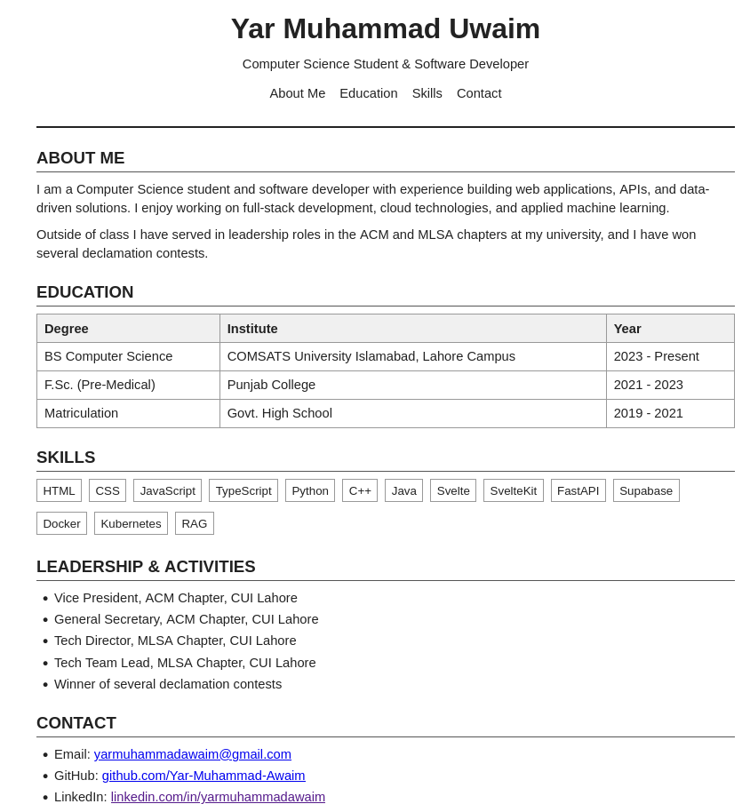

# Problem Statement

Assignment 1 — Your Personal CV Page

Difficulty: Foundational · Covers: Lectures 3–6 (HTML & HTML5, Semantic HTML and Forms, CSS Fundamentals, the CSS Box Model) · Folder: assignment-1/

Task: Build a single-page personal CV/résumé as a static HTML + CSS website — no JavaScript, no framework, just semantic HTML5 and hand-written CSS. This is where you prove you actually know the raw building blocks before anything is allowed to hide them from you.

Your page must include, at minimum:

    A header with your name, a short professional tagline, and a photo (a placeholder image is fine).
    An “About Me” section.
    An “Education” section listing your academic history in a semantic list or table.
    A “Skills” section.
    A “Contact” section with a real <a href="mailto:..."> link and at least one social/portfolio link.
    Correct use of semantic HTML5 elements throughout — <header>, <nav>, <main>, <section>, <article>, <footer> as appropriate, not a page built entirely out of unstyled 
s.
    Styling entirely in a separate styles.css file (external stylesheet, not inline style="" attributes) using the box model correctly — sensible margins, padding, and borders, not everything jammed against everything else.

Deliverables in assignment-1/: index.html, styles.css, any images, and your completion PDF.

# Code

## index.html

<!DOCTYPE html>
<html lang="en">

<head>
    <meta charset="UTF-8">
    <meta name="viewport" content="width=device-width, initial-scale=1.0">
    <title>Yar Muhammad Uwaim - CV</title>
    <link rel="stylesheet" href="styles.css">
</head>

<body>

    <header>
        <h1>Yar Muhammad Uwaim</h1>
        
Computer Science Student &amp; Software Developer

        <nav>
            <ul>
                <li><a href="#about">About Me</a></li>
                <li><a href="#education">Education</a></li>
                <li><a href="#skills">Skills</a></li>
                <li><a href="#contact">Contact</a></li>
            </ul>
        </nav>
    </header>

    <main>

        <section id="about">
            <h2>About Me</h2>
            <article>
                

                    I am a Computer Science student and software developer with experience building
                    web applications, APIs, and data-driven solutions. I enjoy working on full-stack
                    development, cloud technologies, and applied machine learning.
                

                

                    Outside of class I have served in leadership roles in the ACM and MLSA chapters
                    at my university, and I have won several declamation contests.
                

            </article>
        </section>

        <section id="education">
            <h2>Education</h2>
            <table>
                <tr>
                    <th>Degree</th>
                    <th>Institute</th>
                    <th>Year</th>
                </tr>
                <tr>
                    <td>BS Computer Science</td>
                    <td>COMSATS University Islamabad, Lahore Campus</td>
                    <td>2023 - Present</td>
                </tr>
                <tr>
                    <td>F.Sc. (Pre-Medical)</td>
                    <td>Punjab College</td>
                    <td>2021 - 2023</td>
                </tr>
                <tr>
                    <td>Matriculation</td>
                    <td>Govt. High School</td>
                    <td>2019 - 2021</td>
                </tr>
            </table>
        </section>

        <section id="skills">
            <h2>Skills</h2>
            <ul class="skills">
                <li>HTML</li>
                <li>CSS</li>
                <li>JavaScript</li>
                <li>TypeScript</li>
                <li>Python</li>
                <li>C++</li>
                <li>Java</li>
                <li>Svelte</li>
                <li>SvelteKit</li>
                <li>FastAPI</li>
                <li>Supabase</li>
                <li>Docker</li>
                <li>Kubernetes</li>
                <li>RAG</li>
            </ul>
        </section>

        <section id="leadership">
            <h2>Leadership &amp; Activities</h2>
            <ul>
                <li>Vice President, ACM Chapter, CUI Lahore</li>
                <li>General Secretary, ACM Chapter, CUI Lahore</li>
                <li>Tech Director, MLSA Chapter, CUI Lahore</li>
                <li>Tech Team Lead, MLSA Chapter, CUI Lahore</li>
                <li>Winner of several declamation contests</li>
            </ul>
        </section>

        <section id="contact">
            <h2>Contact</h2>
            <ul>
                <li>Email: <a href="mailto:yarmuhammadawaim@gmail.com">yarmuhammadawaim@gmail.com</a></li>
                <li>GitHub: <a href="https://www.github.com/Yar-Muhammad-Awaim">github.com/Yar-Muhammad-Awaim</a></li>
                <li>LinkedIn: <a href="https://www.linkedin.com/in/yarmuhammadawaim">linkedin.com/in/yarmuhammadawaim</a></li>
                <li>Instagram: <a href="https://www.instagram.com/yar_muhammad_awaim">@yar_muhammad_awaim</a></li>
            </ul>
        </section>

    </main>

    <footer>
        
&copy; 2026 Yar Muhammad Uwaim

    </footer>

</body>

</html>

---

## styles.css

`* {
box-sizing: border-box;
margin: 0;
padding: 0;
}

body {
font-family: Arial, Helvetica, sans-serif;
font-size: 11pt;
line-height: 1.45;
max-width: 850px;
margin: 0 auto;
padding: 2rem;
color: #222;
}

header {
text-align: center;
border-bottom: 2px solid #222;
padding-bottom: 1rem;
margin-bottom: 1.25rem;
}

header img {
display: block;
margin: 0 auto 0.75rem;
width: 150px;
height: 150px;
object-fit: cover;
border: 1px solid #ccc;
}

h1 {
font-size: 24pt;
margin-bottom: 0.35rem;
}

.tagline {
font-size: 11pt;
margin-bottom: 0.75rem;
}

nav ul {
list-style: none;
padding: 0;
display: flex;
justify-content: center;
gap: 1rem;
}

nav a {
text-decoration: none;
color: #222;
}

nav a:hover {
text-decoration: underline;
}

h2 {
border-bottom: 1px solid #555;
font-size: 14pt;
margin: 1.2rem 0 0.5rem;
padding-bottom: 0.15rem;
text-transform: uppercase;
}

p {
margin-bottom: 0.5rem;
}

table {
width: 100%;
border-collapse: collapse;
margin-bottom: 0.5rem;
}

th, td {
border: 1px solid #999;
padding: 0.3rem 0.5rem;
text-align: left;
}

th {
background-color: #f0f0f0;
}

.skills {
list-style: none;
padding: 0;
display: flex;
flex-wrap: wrap;
gap: 0.5rem;
}

.skills li {
border: 1px solid #999;
padding: 0.15rem 0.4rem;
font-size: 10pt;
}

ul {
padding-left: 1.25rem;
margin-bottom: 0.5rem;
}

li {
margin-bottom: 0.15rem;
}

footer {
text-align: center;
margin-top: 2rem;
padding-top: 0.5rem;
border-top: 1px solid #999;
font-size: 10pt;
}`

---

# Output

